# CICD-1 Coding Test — Review, Improve and Reflect

**Student ID:G00465240**  
**Examination group:** A (Room Booking / JPQL) or B (OpenFeign): A (Room Booking / JPQL) 
**Original examination pull-request URL (https://github.com/Bill2264/In-ClassCoding_Test_A/pull/1):**  
**New review repository URL:https://github.com/Bill2264/CICD1_reveiw00465240**  

### Task 1 — /40
**My mark: 32**  
**Evidence from the original code (files, methods, working or missing requirements):**
BookingInput was a class and validation was not present 

### Task 2 — /40
**My mark: 20**  
**Evidence from the original code:**
the code has the Post and get request, that work correctly, making persistent bookings and returning all bookings.
however the code lacks Error messages entirely and only checks if attendance count if less than or equal to room capacity.

        public BookingResponse readBooking(Long id) {
        BookingResponse bookingResponse = new BookingResponse();
        Booking booking = new Booking();

        booking = bookingRepository.getBookingById(id);
        bookingResponse.setId(booking.getId());
        bookingResponse.setRoomId(booking.getRoom().getId());
        bookingResponse.setRoomName(booking.getRoom().getName());
        bookingResponse.setOrganiserName(booking.getOrganiserName());
        bookingResponse.setAttendeeCount(booking.getAttendeeCount());
        bookingResponse.setStatus("ACTIVE");
        return bookingResponse;
    }
### Task 3 — /20
**My mark:19**  
**Evidence from the original code:**
the code is fully implemented and does as requested, the only wrong part of it is a grammar mistake where the link says "GET /api/bookings/search?roomname=..." "instead of GET /api/bookings/search?roomName=..."
    

    @GetMapping("/{roomname}")
    public List<Booking> getBookingByRoomName(@PathVariable String roomname){
    return bookingService.getBookingByRoomName(roomname);
    }
**Total self-assessed original examination mark: 71/100**

## 2. Corrections and improvements in my new project

**Problem and correction 1:** 
Dtos where classes and not records
fix: change BookingInput into a record

**Problem and correction 2:** 
validation when making new booking, with my code for the test, there was no validation of if the booking was valid except for is the room capacity was enough for the attendee count.
to fix this, I added checks for various factors like organizer name not being null, attendee count being greater than 0, and room id being for a valid room.
If a error was found, it would throw a new https status bad request and return error code 400 in response.
an example of the code: 
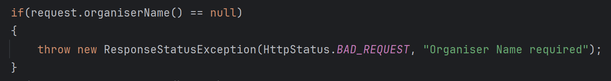

**Problem and correction 3:** 
While I believe it worked for me in the exam, testing the code later revealed that the controller couldn't tell the difference between getBookingById and getBookingByRoomName. this was because they were both Get requests that had the input as a path variable and the code can't tell which one is being referred to when sending a request.
to fix this, I changed the getBookingByRoomName to not use path variable, which makes work as requested with the url being " GET /api/bookings/search?roomName=..."
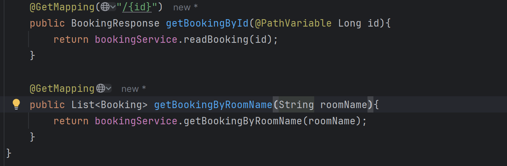
## 3. API testing and evidence

**Test 1 — successful booking request:**  
- Request / input:
- 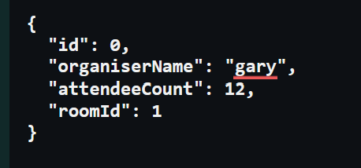
- Expected:  
- 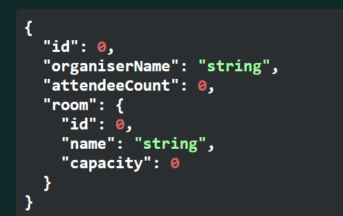
- Actual HTTP status / body:  
- 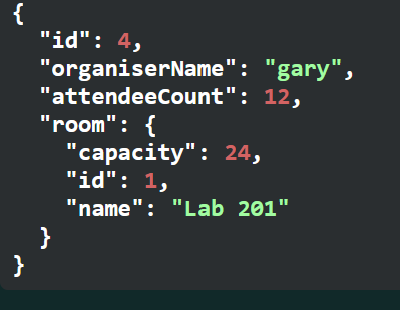
- Pass / fail: Passa  

**Test 2 — invalid input or excessive attendee count:**  
- Request / input:  
- 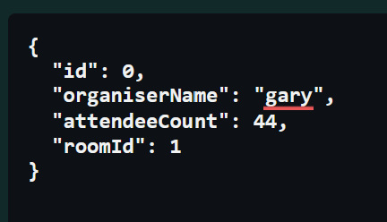
- Expected: Error respond status 400
- Actual HTTP status / body:  
- 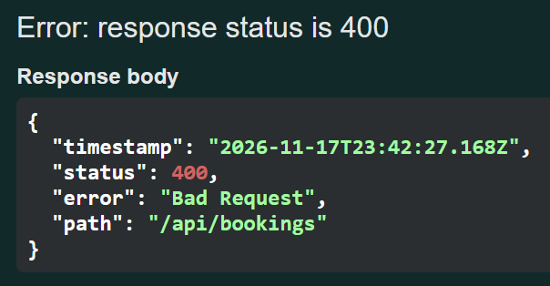
- Pass / fail:  throws error but no message

**Test 3 — missing booking or room:**  
- Request / input:  
- 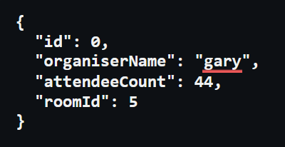
- Expected:  Error respond status 400
- Actual HTTP status / body:  
- 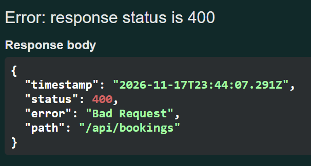
- Pass / fail:  throws error but no message

**Test 4 — requirement specific to my group:**  
- Request / input:  
- 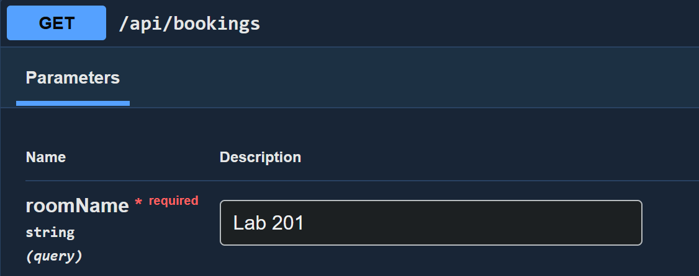
- Expected:  A list of rooms, whose room name matches the input, ordered by attendee count
- Actual HTTP status / body:  
- 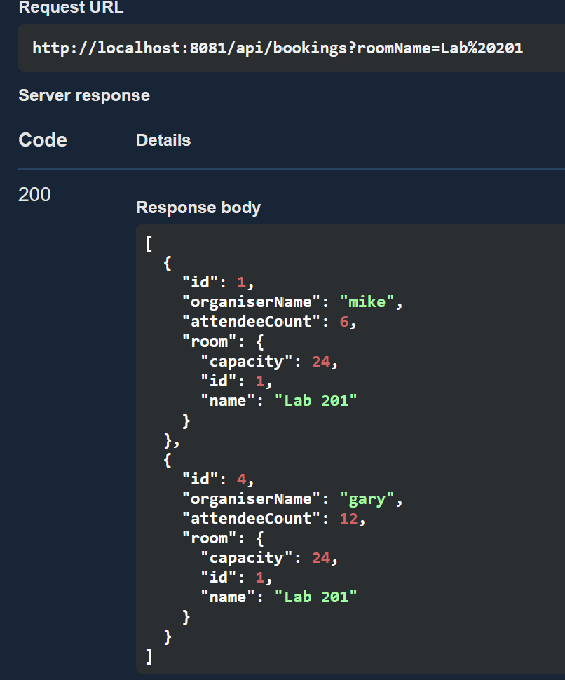
- Pass / fail:  Pass

## 4. Reflection

during the exam, I failed to remember how to implement validation.
I still partly fail to understand how to do it correctly right now, as I don't know how to get the specific error response message to show on swagger ui.
This test helped me realize while I know how to get the desired output, I still don't fully under stand how to do validation and I plan to learn how to implement it correctly for the next test.
